# Galileo

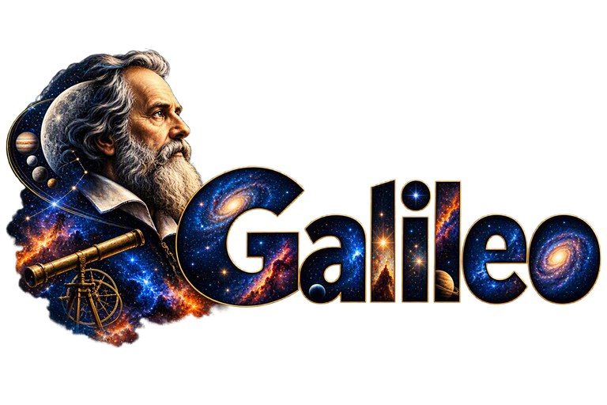

A cross-platform Python-based astrophotography imaging application for Windows, macOS, and Linux — built on [INDI](https://indilib.org/) and [ASCOM Alpaca](https://ascom-standards.org/AlpacaDeveloper/) Supports a mix of INDI and Alpaca devices on multiple piers per observatory, multiple optical tubes and cameras per mount.  

## Installation

**Prebuilt installers (recommended)** — one self-contained download per platform, no Python or Git needed. Get the file for your system from the [Releases page](https://github.com/gordtulloch/Galileo/releases):

| System | File |
|---|---|
| Windows 10/11 x64 | `Galileo-Setup-<version>-win-x64.exe` |
| macOS, Apple Silicon | `Galileo-<version>-macos-arm64.dmg` |
| macOS, Intel | `Galileo-<version>-macos-x86_64.dmg` |
| Linux x86_64 | `Galileo-<version>-linux-x86_64.AppImage` |
| Raspberry Pi 5 / 64-bit ARM Linux | `Galileo-<version>-linux-aarch64.AppImage` |

**Install from source** — a one-file bootstrap script that clones the repo, builds a virtual environment and auto-updates on every launch: [`Install-Galileo-Windows.bat`](Install-Galileo-Windows.bat), [`Install-Galileo-MacOS.sh`](Install-Galileo-MacOS.sh) or [`Install-Galileo-Linux.sh`](Install-Galileo-Linux.sh). Details in [`install/README.md`](install/README.md).

**Developers**: `pip install -e ".[test,dev]"` (Python 3.11+), then `galileo`. The installers are built by [`.github/workflows/release.yml`](.github/workflows/release.yml) from [`packaging/`](packaging/) when a `v*` tag is pushed.

Step-by-step instructions, first-run security prompts (macOS Gatekeeper, Windows SmartScreen) and uninstalling are in the wiki's [Getting Started Guide](https://github.com/gordtulloch/Galileo/wiki/1.-Getting-Started-Guide#install-galileo).

## Why Galileo

Two things motivate this project:

1. **Non-Windows imaging software has a UI/UX gap.** Existing cross-platform options (KStars/EKOS chief among them) have interfaces that have aged over a decade or more of incremental growth. Galileo aims to bring a modern, guided imaging workflow to any platform from Windows to Linux to Mac to Raspberry Pi, using INDI and ASCOM Alpaca so it isn't tied to any one platform's device-driver ecosystem.
2. **Consolidating prior work into one cohesive application.** Galileo's author has built several separate astronomy tools over time — an image manager, a variable-star planner, observatory-automation scripts, an all-sky cloud-detection classifier. Bringing that scattered work together into a single application, rather than maintaining it as several disconnected tools, is a primary goal of this project, not an afterthought.

## Status

**Pre-alpha — early development.** Galileo is a runnable PySide6 desktop application today, not just a design document, but some of its screens are still placeholders pending their own build-out.  Download it and give it a try today! HOWEVER DO NOT USE FOR PRODUCTION PURPOSES.

- **Design docs**: a complete Project Scope Document, a Software Requirements Specification (282 numbered requirements across 28 functional domains and 9 non-functional domains), a Software Design Description covering the full planned architecture, and a Requirements Traceability Matrix at 100% coverage.
- **Automated tests**: one file per SRS domain under `tests/`, run on every CI build with `pytest -m "not soak and not hardware and not integration and not perf"`. Soak, hardware and integration tests are excluded from normal runs. As of 2026-10-10 a local fast run showed one known failure (`test_tc_help_060`, which flags undocumented controls from the VSTarget plugin installed in the developer's venv); the full-suite pass count was not recorded, so the former "773 passing" badge has been removed rather than left stale.
- **What's working today**:
  - A dark-themed shell — a primary icon sidebar (Star Atlas, Planning, Imaging, Guiding, Focus, Solve, Library, Science, then Equipment and Options pinned together at the bottom, since Equipment is a one-time-per-session setup step rather than a screen you switch to and from while working — with Planning opening onto What's Up Tonight, Targets, Sessions and Schedule, and Science onto Variable Stars) plus a context-sensitive second panel per section, a top-bar Observatory/Pier selector, and a status bar. The app opens on Star Atlas.
  - **Planning > What's Up Tonight**: a ranked recommendation layer on top of the Targets catalog, not a second one — for the active Pier's optical train and (optionally) an observing date other than today, ranks catalog objects by a sky-only Observability Score (altitude, Moon separation, horizon obstruction, and, for today only, weather/aurora/smoke advisories) combined with a per-train Fit Score (aperture-derived limiting magnitude, field-of-view fit), each entry showing its own "why" reasons, a reduced-confidence badge when inputs were incomplete, and (when catalogued) prior Library integration time as a display-only annotation. Reuses the Targets page's own Select/Slew To/Add to Session buttons. Aurora (NOAA Kp index, `SAFE-090`) and smoke (NOAA Hazard Mapping System, `SAFE-100`) forecasts are real, advisory-only inputs for today; they show as unavailable when the lookup fails.
  - **Planning > Sessions**: per-Pier, block-based session authoring — a right-hand drag-and-drop palette of action blocks (Target, Image, Filter Change, Cool/Warm Camera, Autofocus, Plate Solve, Guide Start/Stop, Flat Capture, Dark Capture, Park/Unpark Mount, Dome Open/Close/Sync, Notification, plus FOR Filter and FOR Object loop blocks that repeat the indented blocks beneath them) dropped into one bordered card per session, each block coloured with a fixed per-type identity muted into whichever theme is active (rather than a bright, glaring tile), with Save / Save as Template / Load from Template / Schedule / Run / Delete controls; a scheduled session locks read-only with a red border. Right-clicking a block on the panel opens its own parameter dialog directly, no menu (exposure/count/filter/binning/gain/offset/frame-type for Image, RA/Dec for Target, and so on); a block with no parameters (Park Mount, Plate Solve, …) does nothing on right-click. The Image block's dialog includes its own **Framing / Mosaic…** control for defining a mosaic grid. A block type that requires a preceding Target block (currently just Plate Solve) shows a clear warning, not a silent refusal, if dropped without one, and inserts correctly whether dropped before or after an existing block. Dragging a block out of the panel entirely (and releasing it outside the palette and every session's block list) deletes it. Selecting a target on the Star Atlas auto-creates a session pre-populated with a Target block. Session/scheduler-job data and named templates persist to the same shared database as everything else. Run schedules a session to start immediately and reports (without blocking) any overlap with other timeline entries on the same Pier. The Run button executes a session's blocks against the connected devices (`galileo/sequencer/session_exec.py`), and the scheduler uses the same engine. Flat Capture supports Sky Flats, Flat Panel and Observatory Panel. Dither and Meridian Flip are no longer in the palette (sessions saved earlier still load).
  - **Planning > Schedule**: a per-Pier calendar over the job queue a Session's Schedule/Run control submits to (`galileo.scheduler.ObservatoryScheduler`) — the only screen onto that queue; the earlier Planning > Scheduler table screen was removed once this one existed. A multi-day grid — one column per observing night, a shared hour axis running dusk (top) to dawn (bottom) so the night itself sits centered rather than split across a plain calendar day's midnight-crossing edges, a mini month calendar for jumping to a start date, Zoom In/Out and Fewer/More Days controls — replaces the old single-day timeline and its right-hand block-type drag palette; the five standalone pier-level operations (Open Dome, Close Dome, Unpark Scope, Park Scope, Dome Sync) are added instead from an "Add Pier Operation" entry on the grid's own right-click menu, with no session attached. Every entry (session or pier operation) is one block sized to its duration; right-click to set/clear a start time, end time, and duration, or drag a block to a new day/time to move it; a job with no start time yet is itself a small draggable block in the Unscheduled tray below the grid — drag it onto the grid to give it a start time, or leave it there for a future autoscheduler to place. Back Day/Today/Day Forward shifts the visible range, clamped to 7 days in the past and open-ended going forward. When the Pier's Observatory has a latitude/longitude set, the shared hour window is the widest sunset-to-sunrise span among the visible nights (a fixed 17:00–07:00 window otherwise), each column shaded by that night's own daylight/twilight/darkness and labelled with its Moon phase (toggled by a Show Almanac Shading checkbox); a Show Past Events checkbox reveals elapsed entries hidden by default. A completed entry gets a green border, an errored one a red border, and every block has a Log button — only as useful as what the session engine writes to it. The Autoschedule button in the top bar has no logic behind it yet. Right-clicking a session block also offers **Edit…** (priority, constraints, startup/completion conditions, frames required) and **Show Trajectory…** (altitude-over-time chart).
  - **Guiding** (its own sidebar section, below Imaging): connects to PHD2 by host and port and shows its live state — guide-star image, guide graph, drift and calibration plots, guide statistics and event log — with Loop/Guide/Stop/Dither/exposure controls.
  - **Focus** (its own sidebar section, below Guiding): follows an autofocus run live — the frame being measured, star count / HFR / FWHM, and the HFR V-curve with its fit and best position — and only updates while a run is in progress, whether started by its own Auto Focus button or by another part of the app. Start/Stop, step size, points and exposure work; Aberration Inspector, CFZ and Advisor buttons are placeholders.
  - **Solve** (its own sidebar section, below Focus): plate solving with the frame being solved and its results on show. **Capture & Solve** takes an exposure with the selected camera and solves it with ASTAP (using the mount's position as a search hint), then syncs the mount, slews back to the target until within an accuracy you set, or just reports the error; **Load & Slew…** solves a FITS file and slews to it; **Stop** cancels. It shows every solve, whichever part of Galileo started it, and only updates while it is in view. Needs [ASTAP](https://www.hnsky.org/astap.htm) and a star database installed (found on `PATH` or in its usual install folder). ASTAP is the only solver. The **Polar Alignment** tab solves three frames while turning the mount in RA, finds where its polar axis really points, and shows the error against the pole as an altitude and an azimuth correction that keeps updating while you turn the mount's knobs (exact wherever the camera points, for a level mount; refraction is allowed for unless you turn it off). It refuses a rotation that would take the mount across the meridian. It needs a connected camera and mount and the Observatory's latitude and longitude.
  - **Equipment**: per-device-category (Camera, Mount, Filter Wheel, Focuser, Rotator, Switches, Flat Panel, Weather, Dome, Safety Monitor) Driver/Server/Port connection panels that do a real INDI or Alpaca scan against a live device — including Alpaca Management API discovery and `.local` mDNS hostname resolution (e.g. a Seestar's `seestar.local` bridge).
  - **Observatory/Pier**: persisted master records (name, lat/long, timezone, physical address, owner for Observatories; name for Piers) saved to a local SQLite database via Peewee, selectable/creatable from the top bar, surviving restarts. Two Piers can each run their own Imaging capture, Autofocus or Plate Solve at the same time — switching the top-bar Pier selector re-points every Equipment/Imaging/Focus/Solve control to whatever's actually connected/running on that Pier, without disturbing whichever Pier isn't currently shown (see [`docs/SDD.md`](docs/SDD.md) Section 4.4b).
  - **Star Atlas**: a basic planetarium — stars, deep-sky objects (Messier, Caldwell and NGC catalogs, chosen with the panel's Catalogs **+** button), Sun/Moon/planets for the Observatory's location and a chosen (or live) time, with optional constellation boundaries and constellation outlines (stick figures), pan/zoom, click-to-identify and centre-and-track. A horizon obstruction table can be uploaded under **Options > Star Atlas** and shaded on the map with the **Horizon** checkbox; **Options > Planning** can then refuse slews into it. Each Pier in the Observatory gets a labelled telescope reticle (the **Telescope markers** checkbox) that sits where its mount is pointing and travels across the sky as the mount slews, with a dotted line to the target it is heading for. No comets/satellites, and no FOV rectangle yet.
  - **Planning** (formerly Sky Atlas): a real search-criteria panel wired to the catalog search/filter backend.
  - **Framing Assistant**: opened contextually — never a top-level menu item — via the Imaging tab's **Framing…** control: a DSS survey image for the target with the FOV rectangle (or every pane's rectangle, for a mosaic grid) drawn on top, updating live as rotation/mosaic-grid/overlap settings change, cached offline after the first fetch. FOV is computed from the selected optical train; rotation is always available — with a rotator connected, accepting the dialog moves it to the requested angle, and with none connected the tilt is instead covered by an auto-sized mosaic of un-rotated panels (a status line says which applies), with the originally-requested tilted frame shown as a dashed outline for context. Defining a mosaic adopts it as the Imaging tab's active capture target — the tab shows a "Mosaic active" status line and its Capture button relabels to **Capture Mosaic** so it's clear before pressing it that the whole grid will be shot, and pressing it actually slews to and exposes every pane in pane-major order, not just a single frame; a **Clear Mosaic** button reverts to one. A Session Image block gets its own, independent **Framing / Mosaic…** entry point too (opened from its right-click parameter dialog on Planning > Sessions), sharing the same underlying `FramingAssistant` model without the survey-image preview or rotator control. Constellation/grid overlay isn't drawn yet.
  - **Imaging**: a live, pan/zoomable auto-stretch preview (`QGraphicsView`) with a histogram, per-frame statistics (mean/median/min/max/star count/HFR), manual single-exposure capture run off the UI thread with a live countdown, an independent Save Frame action, a portrait/landscape layout that follows the frame (the preview narrows to a third of the width and the nudge pad, histogram and log move to its left for a portrait frame, with a manual override), a N/S/E/W mount nudge pad for the connected mount, and a per-Pier current object (picked in the Star Atlas, shown top right) that names saved frames and is what Solve's Slew to Target slews to, a Quantity/Gain pair that takes a run of frames and files each one straight into the Library, and a Live Stack option that registers and combines a run into one image as it is taken, saveable to the Library or a file. Every frame it writes is saved in a FITS sample format other astronomy software can actually read, no 64-bit images, with an Options > Imaging screen to fix that format if the automatic choice isn't what you want. A **Flats…** button opens the Flats Assistant (Flat Method, Exposure — blank to calculate, Number of Frames, Filter with an All option, Average/Median ADU Method, Exposure Increment); **Sky Flats** refuses to start outside local dawn/dusk twilight, slews to a star-poor patch of sky in the East with tracking off, and converges each frame's exposure on 50% of the camera's Max Well Depth (set on Equipment > Camera), re-checking and retaking every frame as twilight brightness drifts. **Flat Panel** (enabled only while a flat panel is connected) and **Observatory Panel** run the same off-thread assistant, converging exposure and, for a Flat Panel, panel brightness on the target; an unreachable target is reported in a dialog.
  - **Library** (AstroFiler's screens, in its own sidebar section): **Images** (the catalog by object), **Sessions** (imaging sessions, linked calibration sessions, master frames, calibrating lights), **Mappings** (FITS header-value rules), **Dedup** (duplicate files), **Merge Objects** (rename an object across the catalog) and **Cloud** (Google Cloud Storage backup and sync). Its settings are under **Options > Library**. The catalog lives in the same database as everything else, built by migrations, and an existing AstroFiler database opens as it is. AstroFiler's twelve command-line utilities are installed as `galileo-load-repo`, `galileo-create-sessions`, `galileo-link-sessions`, `galileo-auto-calibration`, `galileo-cloud-sync` and so on, for scheduled or headless use.
  - **Logging**: a runtime logging service capturing all application output to a datestamped, per-run-reset log file under `logs/`, plus a live scrolling log tail on every Equipment device screen ala KStars.
- **Options pages**: Library, Star Atlas, Planning, Imaging, Focus, Solve, Notifications (e-mail/SMS delivery, with a test send), Plugins, Equipment (the crash/hang watchdog), Guiding (PHD2 dither and settle parameters) and Science (a note: core has no science settings) are real. Science > Variable Stars is a stub until the VSTarget plugin is installed. All of these settings (and panel layouts, equipment profiles and the Library settings) are stored in the shared database's `app_settings` table, not in JSON/ini files; settings files from older versions are imported once and renamed `*.migrated` (`ARCH-090`).
- **Plugins**: Options > Plugins installs a plugin from a local ZIP or from the Plugin Marketplace (an index in the Galileo-Plugins repository), and removes installed plugins. Updating a plugin in place is not implemented. VSTarget, Kasa Switch and Generic Relay now live outside this repository and install through that mechanism.
- **Not implemented yet** (the full list is in [`TODO.md`](TODO.md)): the multi-Pier status dashboard (`OBS-060`) is now a Dashboard screen (the crash/hang watchdog, `SAFE-060`, and dome slaving, `DOME`, now are); and comet/asteroid/satellite display in the Star Atlas are missing; and there is no crash-report handler.

## Support

Need help or want to chat with other users? Join the [Galileo Discord](https://discord.gg/cnTuRwejd). Bugs and feature requests go to [GitHub Issues](https://github.com/gordtulloch/Galileo/issues).

## Getting Started

Please see the Wiki for the Getting Started Guide.

## Documentation

| Document | Contents |
|---|---|
| [`docs/PSD.md`](docs/PSD.md) — Project Scope Document | Goals, non-goals, functional/non-functional requirement domains, constraints, risks |
| [`docs/SRS.md`](docs/SRS.md) — Software Requirements Specification | Numbered, testable requirements decomposed from the PSD |
| [`docs/SDD.md`](docs/SDD.md) — Software Design Description | Architecture, module-by-module design, and the design decisions (ADRs) behind it |
| [`docs/RTM.md`](docs/RTM.md) — Requirements Traceability Matrix | Every SRS requirement mapped to its SDD component and a reserved test-case ID; generated from the SRS/SDD text, 100% coverage |

## Planned Capabilities

- **Equipment control** for cameras, mounts, filter wheels, focusers, rotators, guiders, domes, and safety/weather monitors, via INDI or ASCOM Alpaca only — mixed freely within one setup, with no bypass even for software-computed signals: a hardware rain sensor (Tier 1) and an ML-based cloud classifier (Tier 2) both connect as ordinary INDI/Alpaca Safety Monitor devices
- **Guided imaging** with a basic sequencer and an advanced instruction/condition/trigger sequencer
- **Sky navigation**: a catalog-based Sky Atlas, a Framing Assistant, and a live interactive planetarium-style Sky Map
- **Autofocus, plate solving, automated meridian flip, and external-guider integration**
- **A multi-night observatory Scheduler** with altitude/moon/twilight/horizon constraints and weather-gated execution
- **Multi-mount observatory management**: one Galileo instance coordinating several independent telescopes ("Piers"), with shared or per-telescope dome/safety scoping — deliberately going beyond what EKOS itself supports
- **An image library and repository manager**: cataloging, deduplication, smart-telescope ingestion, master calibration-frame creation/application, quality metrics, live auto-registration of frames during acquisition into sequence-scoped session containers, and command-line batch utilities for scanning/sync
- **A variable-star workflow**: AAVSO target planning and photometric analysis/reporting, delivered as pre-loaded first-party plugins that are a peer to the Sky Atlas when enabled — including submitting a target straight into the Scheduler from the plugin's own UI
- **Layered safety monitoring**: any connected Safety Monitor device — hardware (Tier 1) or software-computed (Tier 2) — trusted for automated aborts, with an independent crash/hang watchdog
- **An extensible plugin architecture**: first-party plugins (pre-loaded, individually enabled/disabled, functionally equivalent to core when on) alongside a third-party plugin manager
- **FITS-primary image I/O**, including required tile-compressed FITS — XISF is accepted on import and converted best-effort to FITS, but never used as Galileo's own output/working format

See the [PSD](docs/PSD.md) for the full requirement domain list and what's explicitly out of scope for v1.

## Built On

Galileo consolidates and builds on several of the author's existing projects:

- [AstroFiler](https://github.com/gordtulloch/astrofiler-gui) — image cataloging and calibration processing (merged in full)
- [VSTarget](https://github.com/gordtulloch/VSTarget) — AAVSO variable-star planning and photometry (merged in full)
- [Obsy](https://github.com/gordtulloch/obsy) — target-visibility and sky-survey-thumbnail logic (retired as an app, its GPL-3.0 code ported directly into the Sky Atlas/Framing Assistant)
- [AstroLlama](https://github.com/gordtulloch/AstroLlama) and [MCP](https://github.com/gordtulloch/MCP) — selectively harvested for specific device-abstraction and safety-sensor functionality

See the PSD's Background section for the full picture of what's merged, harvested, or kept as reference only, and why.

## Tech Stack

Python 3 with [PySide6](https://doc.qt.io/qtforpython/) (Qt for Python), chosen for native rendering performance on all platforms including ARM SBCs and direct reuse of the existing Python astronomy ecosystem (`astropy`, `peewee`, `zeroconf`). See [SDD Section 2.1](docs/SDD.md) for the full rationale.

**On the GIL:** people considering Python for a desktop imaging app reasonably ask about the Global Interpreter Lock. It matters here, and Galileo handles it based on measurements rather than assumptions. Pure-`numpy` work (stretching, debayering, histograms, FFTs) releases the GIL, so running it in a background thread keeps the UI responsive. SEP star detection and astroalign registration don't release it: profiled on a 26 MP frame, they froze the event loop for 1.7–2.9 s even from a background thread. That work goes to a `ProcessPoolExecutor` (`galileo.core.compute`), which cuts the stall to under 80 ms. See [SDD §2.1/§2.3](docs/SDD.md) for the details.

**On moving to Python 3.14:** The latest version of Python has a lot of performance improvements including free-threading which eliminates the GIL bit at a general 10-15% performance reduction so the author has decided to hold off on moving from 3.11 for the time being, particularly to ensure that libraries are properly implemented for the new features (otherwise the whole program reverts to GIL). 
## Reference Test Environment

Galileo's design is validated against the author's own physical multi-Pier Observatory: a roll-off-roof shed ([indi-rolloffino](https://github.com/wotalota/indi-rolloffino)), an INDI weather station ([indi-argentweather](https://github.com/gordtulloch/indi-argentweather)) and rain monitor ([indi-hydreon](https://github.com/gordtulloch/indi-hydreon)), and three independent Piers — a Seestar S30 and a Seestar S30 Pro (both connected via ASCOM Alpaca) and a 62 mm refractor on an OnStep mount (connected via INDI). See [PSD Section 6.8](docs/PSD.md) for details.

## License

Copyright (C) 2025-2026 Gord Tulloch. Licensed under [GPL-3.0-or-later](LICENSE). Every source file carries an `SPDX-License-Identifier` and copyright header.

## Contributing

Contributions are welcome. All contributors must agree to the Contributor License Agreement (CLA) in [CONTRIBUTING.md](CONTRIBUTING.md), which also covers the development setup, test conventions and changelog requirements.

## Author

[Gord Tulloch](https://github.com/gordtulloch)

## Screenshots

### Equipment

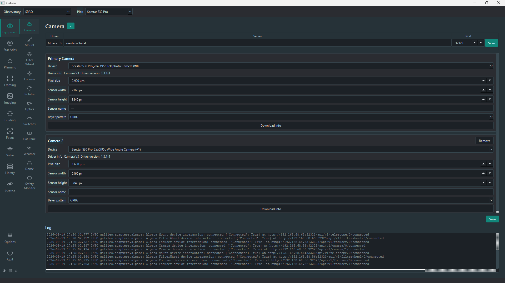

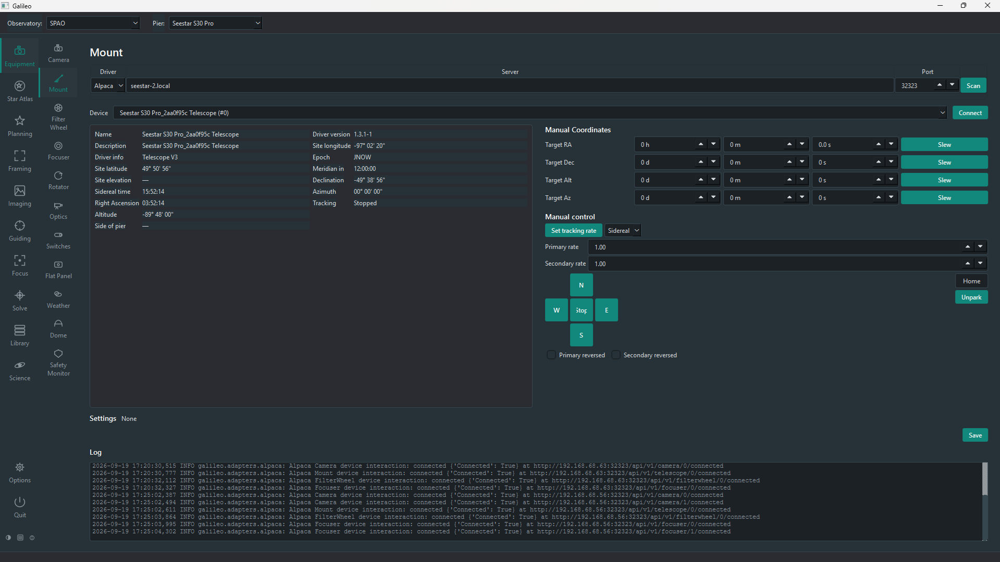

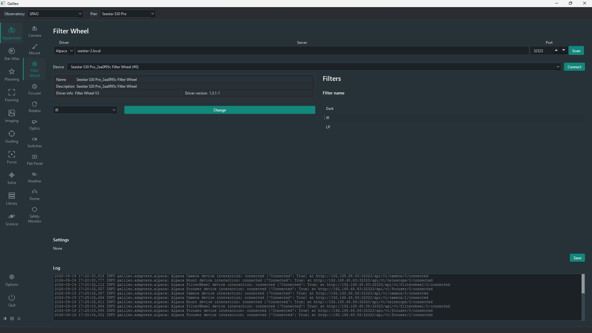

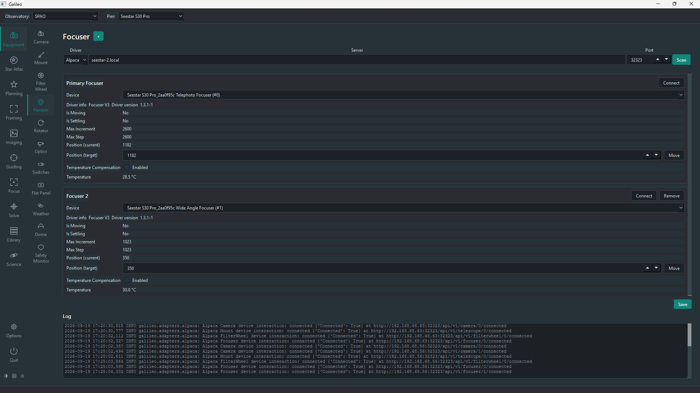

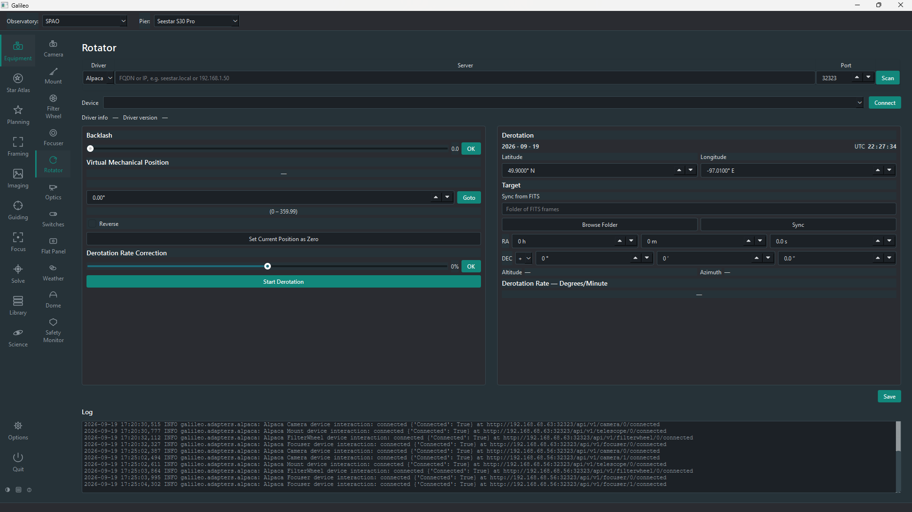

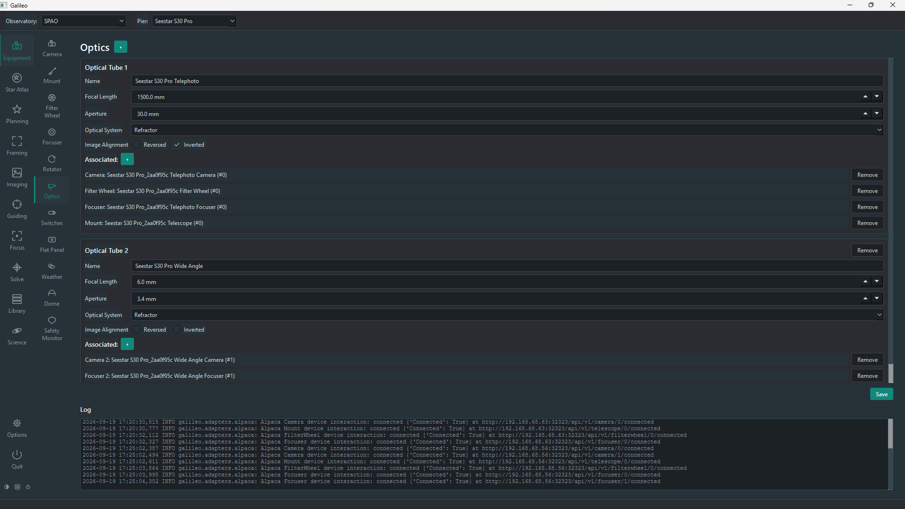

### Imaging

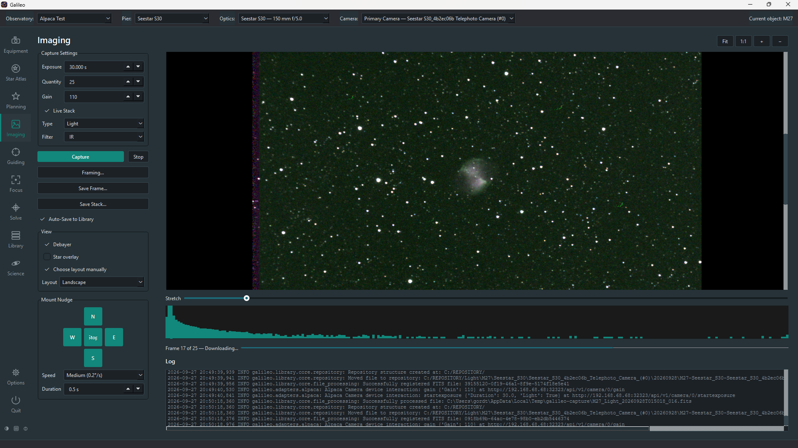

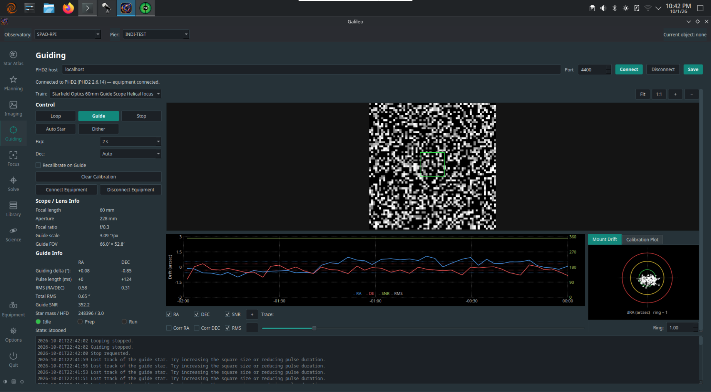

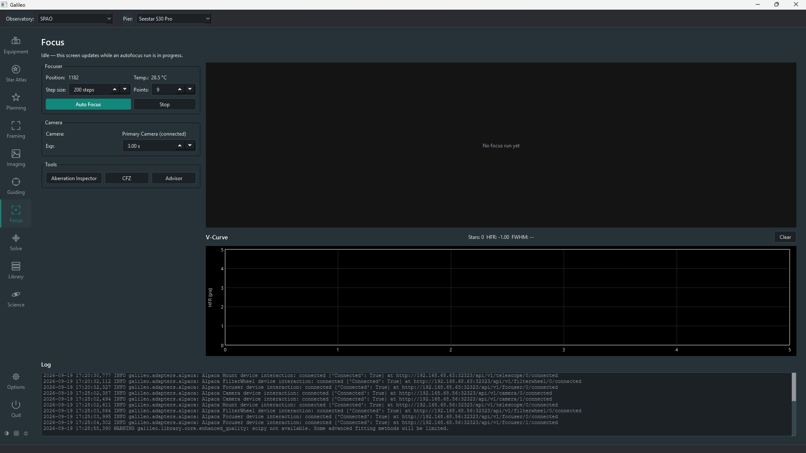

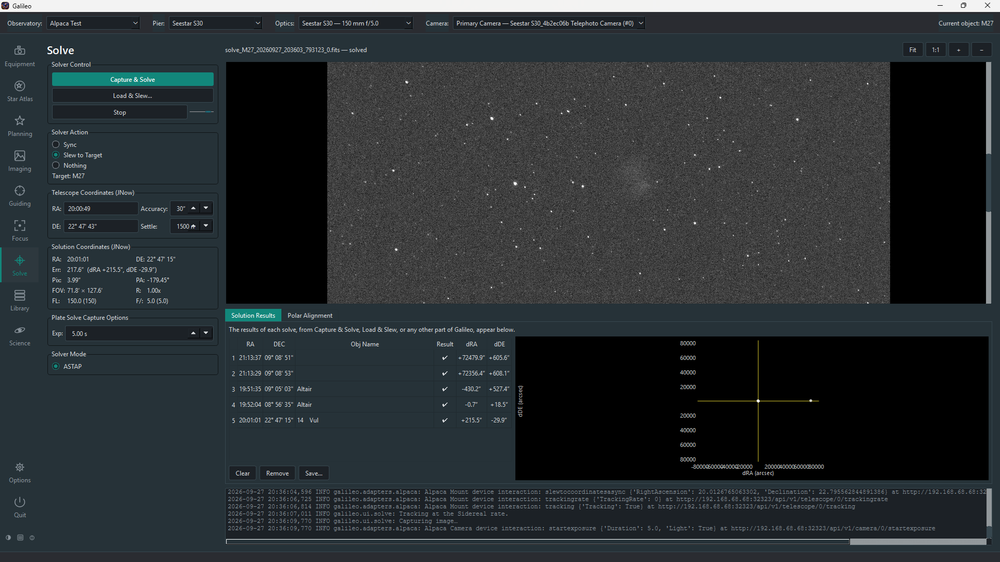

### Planning and Library

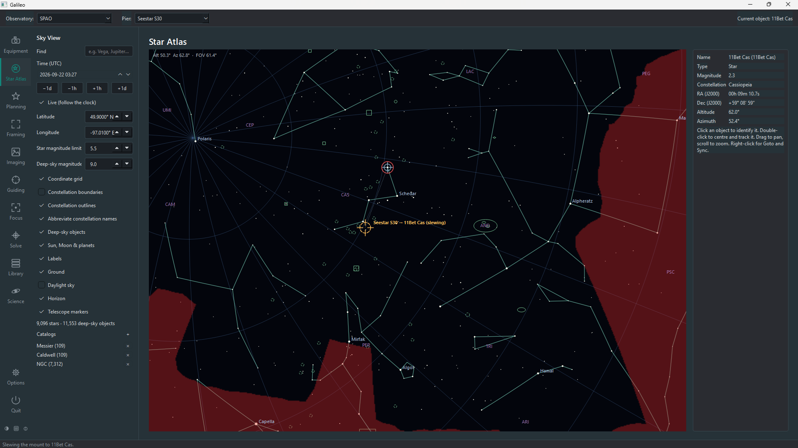

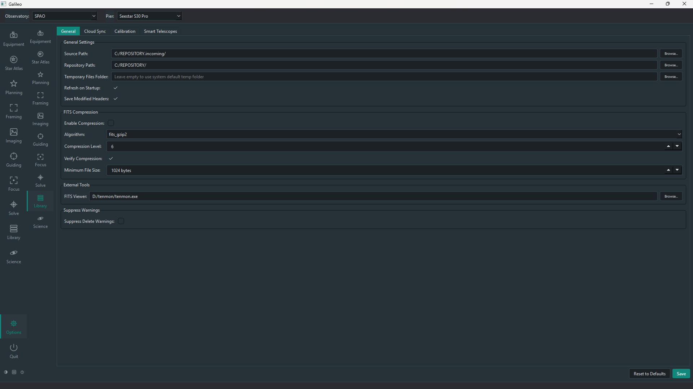
